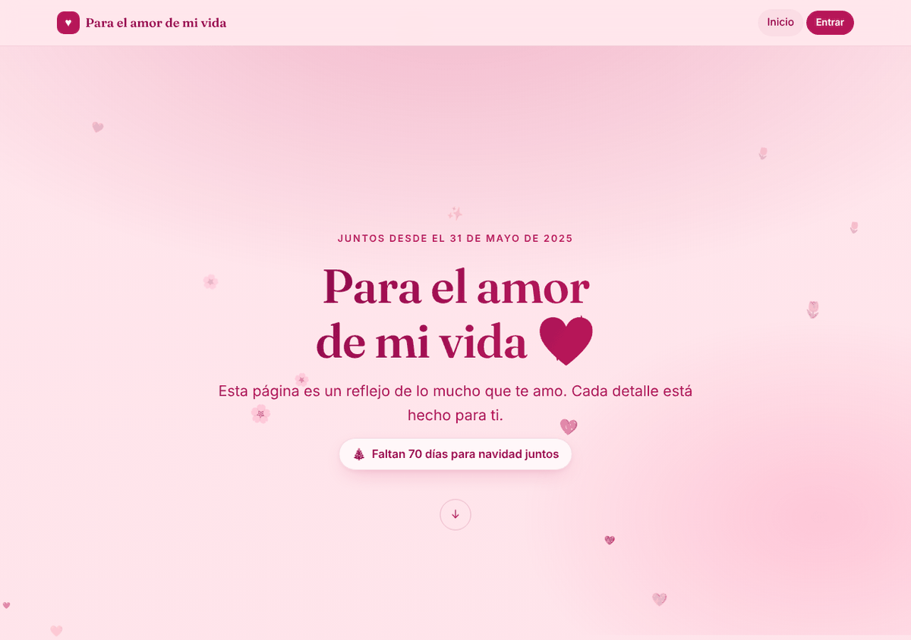
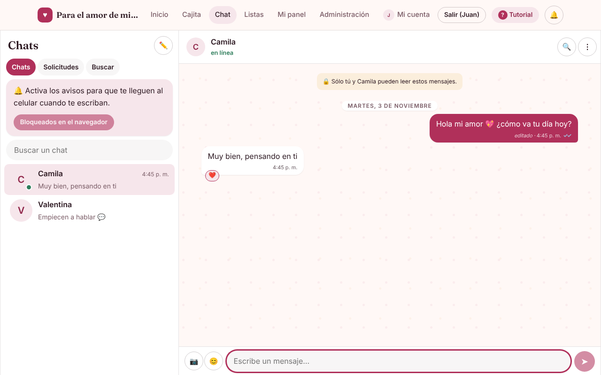
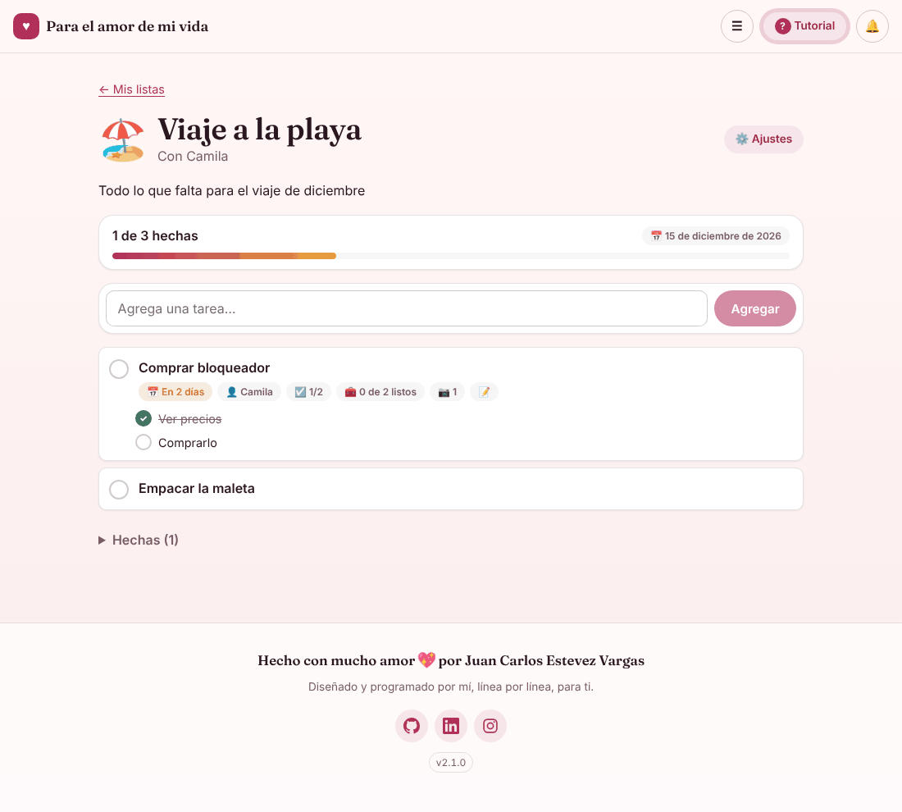
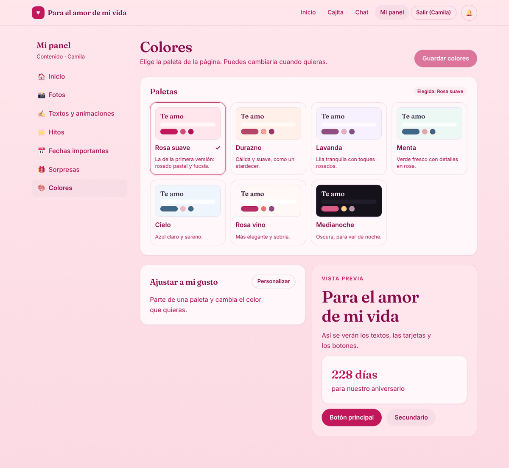
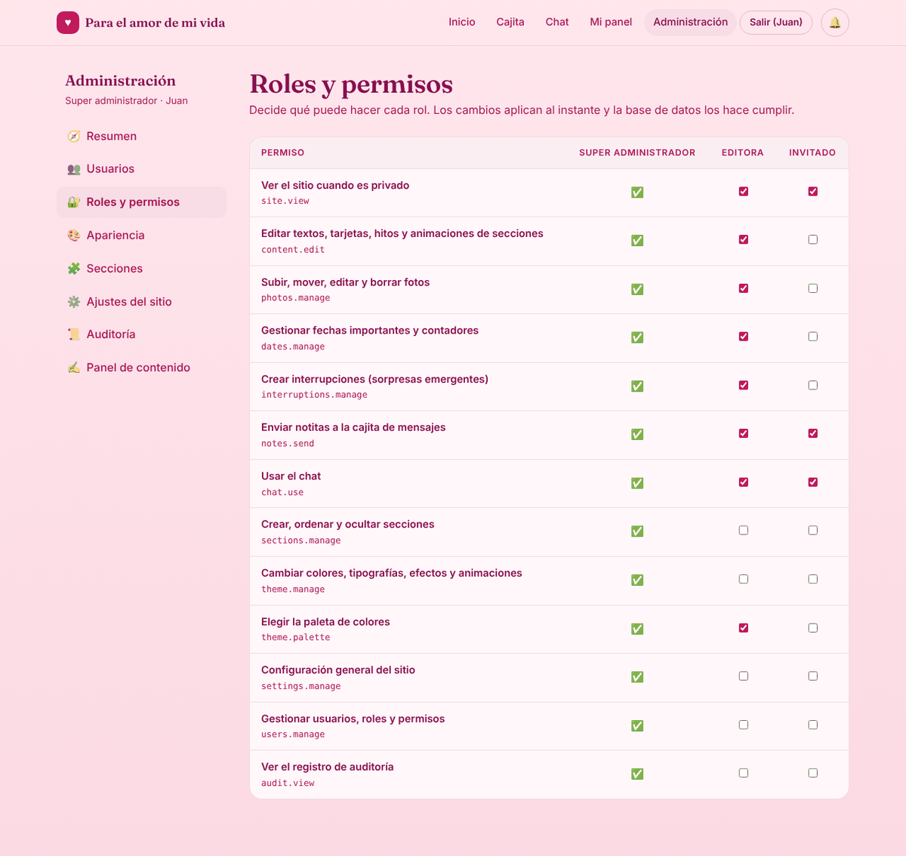
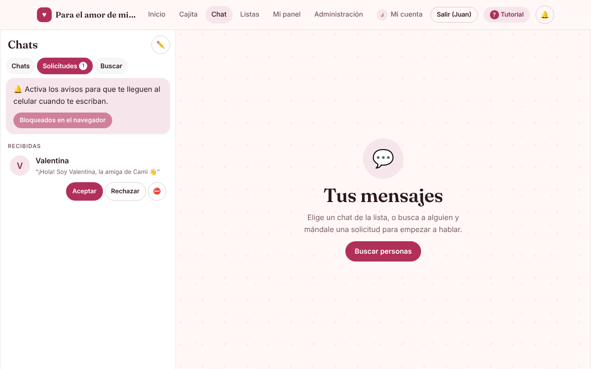
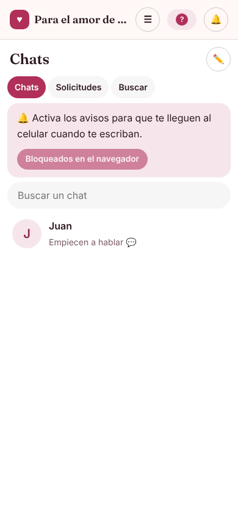
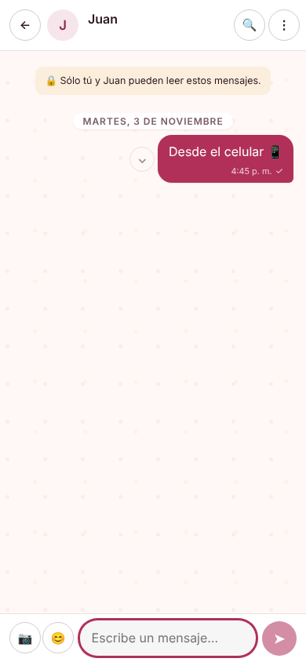
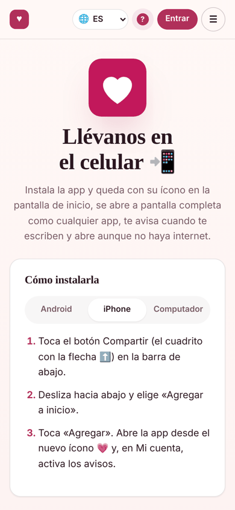
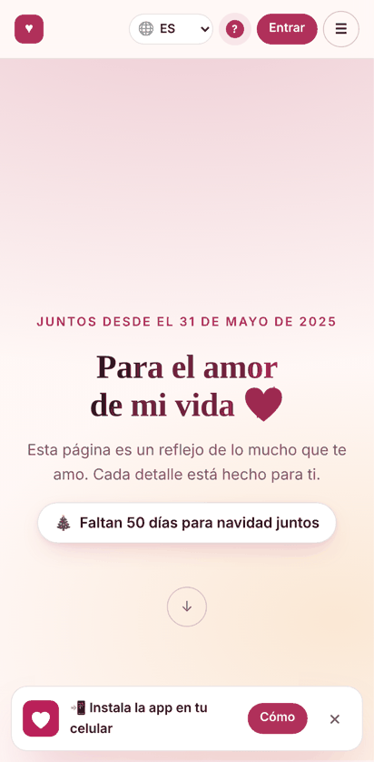

<div align="center">


# Para el amor de mi vida

**Una aplicación web privada para una pareja: recuerdos, fechas, una app de chat con solicitudes de contacto y listas compartidas, con su propio panel de administración.**

[](https://github.com/Juan-Carlos-Estevez-Vargas/Camila-Sanchez/actions/workflows/ci.yml)
[](https://github.com/Juan-Carlos-Estevez-Vargas/Camila-Sanchez/actions/workflows/deploy.yml)
[](https://github.com/Juan-Carlos-Estevez-Vargas/Camila-Sanchez/actions/workflows/codeql.yml)
[](https://scorecard.dev/viewer/?uri=github.com/Juan-Carlos-Estevez-Vargas/Camila-Sanchez)
[](https://github.com/Juan-Carlos-Estevez-Vargas/Camila-Sanchez/releases)
[](LICENSE)
[](https://ko-fi.com/juancarlosestevezvargas)


[**Ver en vivo**](https://camila-sanchez.netlify.app) ·
[Manual de usuario](docs/MANUAL_DE_USUARIO.md) ·
[Arquitectura](docs/ARQUITECTURA.md) ·
[Despliegue](docs/DESPLIEGUE.md)



</div>

## Tabla de contenido

- [Descripción](#descripción)
- [Capturas](#capturas)
- [Funcionalidades](#funcionalidades)
- [Tecnologías](#tecnologías)
- [Inicio rápido](#inicio-rápido)
- [Scripts](#scripts)
- [App de celular](#app-de-celular)
- [Arquitectura](#arquitectura)
- [Seguridad y privacidad](#seguridad-y-privacidad)
- [Idiomas](#idiomas)
- [Accesibilidad y SEO](#accesibilidad-y-seo)
- [Legal y privacidad](#legal-y-privacidad)
- [Despliegue y versiones](#despliegue-y-versiones)
- [Documentación](#documentación)
- [Contribuir](#contribuir)
- [Apoyar el proyecto](#apoyar-el-proyecto)
- [Licencia](#licencia)

## Descripción

*Para el amor de mi vida* es una aplicación web progresiva (PWA) hecha a
medida para Camila. La página principal reúne la historia de la pareja:
tiempo juntos, cuentas regresivas a fechas especiales, hitos, una galería de
fotos por año y mes, una carta y sorpresas. Detrás hay un producto completo:
cuentas con roles y permisos, una app de chat (buscar personas, solicitudes,
chats privados con reacciones, edición y vistos), listas de tareas
compartidas, avisos en la pantalla del celular y un panel para editar todo sin
tocar código.

Funciona en dos modos:

- **Producción**, con Supabase como backend (Postgres con Row Level Security,
  autenticación, almacenamiento privado, tiempo real y Edge Functions).
- **Demo**, sin cuentas ni configuración: todo se guarda en el navegador y dos
  pestañas se comunican entre sí, ideal para probarla en local.

> La primera versión (HTML/JS estático) se conserva en [`legacy/`](legacy/README.md).

## Capturas

| App de chat | Listas compartidas |
| --- | --- |
|  |  |
| **Paletas de colores por persona** | **Roles y permisos** |
|  |  |
| **Solicitudes de contacto** | **La bandeja en el celular** |
|  |  |

<p align="center">
  <br>
  <sub>Diseño adaptable: la misma app en el celular, instalable con su ícono (ver <a href="#app-de-celular">App de celular</a>).</sub>
</p>

## Funcionalidades

| Área | Ruta | Acceso |
| --- | --- | --- |
| Página principal: portada, tiempo juntos, cuentas regresivas, notas, hitos, galería por año/mes, carta y frases | `/` | Pública o con `site.view` |
| Cajita de mensajes: notitas que se abren como una carta y las sorpresas recibidas, guardadas | `/mensajes` | `notes.send` |
| App de chat a pantalla completa: buscar personas, solicitudes de contacto, chats privados, fotos, stickers, responder, reacciones (en el celular, manteniendo pulsado el mensaje), editar y borrar, «escribiendo…», en línea, vistos (✓ ✓✓), buscar mensajes, fijar, silenciar, archivar y bloquear | `/chat` | `chat.use` |
| Listas compartidas con subtareas, materiales, fotos, fechas y responsables, en vivo | `/listas` | `lists.use` |
| Perfil: nombre, foto o icono, frase y cumpleaños | `/cuenta/perfil` | Cualquier cuenta |
| Mis colores: cada persona elige su paleta sin cambiársela a nadie | `/cuenta/colores` | Cualquier cuenta |
| Mi cuenta: app en el celular, avisos en el dispositivo, contraseña y sesiones | `/cuenta` | Cualquier cuenta |
| Panel de contenido: fotos, textos y animaciones, hitos, fechas y sorpresas (cada sorpresa se prepara para una persona: sólo ella la ve, nunca quien la creó) | `/panel` | Editora y super admin |
| Super admin: usuarios, invitaciones por enlace o QR, roles y permisos, apariencia, secciones, ajustes y auditoría | `/super` | Super admin |
| App de celular instalable (Android, iPhone y computador): ícono, pantalla completa, atajos, sin conexión y aviso de versión nueva | `/app` | Pública |
| Avisos push en el celular: chat, notitas, sorpresas y listas | — | Quien los active |
| Tutorial guiado según la página y los permisos de cada cuenta | Todas | Todos |
| Idiomas: español, inglés y portugués. La app arranca en el idioma del dispositivo y se cambia con 🌐 en la cabecera, el pie o **Mi cuenta** | Todas | Todos |
| Legal: privacidad, términos, cookies, cobros y licencias; aviso de cookies y aceptación de términos | `/legal` | Pública |
| Botón opcional «Invítame un café», destacado en la cabecera y en el pie (donación voluntaria por un enlace externo) | Cabecera y pie | Todos, si `VITE_DONATION_URL` tiene valor |

**Fotos optimizadas en el navegador.** Cada imagen pasa por un *pool* de Web
Workers con `OffscreenCanvas`: corrige la orientación EXIF, elimina metadatos
(GPS incluido), la reduce a 2048 px y la codifica en WebP (JPEG como respaldo)
hasta unos 450 KB, más una miniatura de 480 px. La carga masiva acepta
carpetas completas (hasta 1000 fotos por tanda), ubica cada foto en el mes en
que se tomó, salta duplicados con una huella SHA-256 y permite reintentar las
que fallen.

Dentro de cada mes las fotos siguen el orden que se elige en el panel (↑ ↓ o
arrastrando), aunque sean de días distintos; la fecha sólo decide el mes.

## Tecnologías

| Capa | Tecnología |
| --- | --- |
| Interfaz | React 19, TypeScript estricto, React Router 7 |
| Estilos | SCSS con módulos de Sass (`@use`/`@forward`), BEM y CSS Modules |
| Build y pruebas | Vite 8, Vitest, ESLint |
| Backend | Supabase: Postgres con RLS, Auth (PKCE), Storage privado, Realtime y Edge Functions en Deno |
| App de celular | PWA: manifiesto, service worker con precarga y actualización, `beforeinstallprompt`; Trusted Web Activity opcional para Google Play |
| Avisos | Web Push (VAPID), service worker, `pg_net` y Supabase Vault |
| Calidad | Pruebas de RLS sobre PGlite, `npm audit`, Dependabot, CodeQL, OpenSSF Scorecard, acciones fijadas por SHA |
| Publicación | Netlify (web) y GitHub Actions (migraciones, funciones y releases) |

## Inicio rápido

Requisitos: **Node.js 20 o superior** (CI y Netlify usan Node 22).

```bash
git clone https://github.com/Juan-Carlos-Estevez-Vargas/Camila-Sanchez.git
cd Camila-Sanchez
npm install
npm run dev
```

Sin variables de entorno la app arranca en **modo demo**. Abre dos ventanas
para probar el chat y las notificaciones entre cuentas.

| Cuenta demo | Contraseña | Rol |
| --- | --- | --- |
| `juan@demo.local` | `demo1234` | Super administrador |
| `camila@demo.local` | `demo1234` | Editora |
| `valentina@demo.local` | `demo1234` | Invitada (le pide chatear a Juan) |

Para conectarla a un proyecto de Supabase, copia `.env.example` a
`.env.local` y completa los valores. La guía completa está en
[docs/DESPLIEGUE.md](docs/DESPLIEGUE.md).

## Scripts

| Comando | Qué hace |
| --- | --- |
| `npm run dev` | Servidor de desarrollo (modo demo si no hay `.env.local`) |
| `npm run check` | Typecheck, lint y pruebas, lo mismo que exige CI |
| `npm run build` | Compilación de producción en `dist/` |
| `npm run preview` | Sirve la compilación de producción en local |
| `npm run security` | Busca secretos en el repo y su historial, y revisa las dependencias de la app y de las Edge Functions |
| `npm run db:setup-sql` | Regenera `supabase/setup.sql` a partir de las migraciones |
| `npm run release:preview` | Muestra la versión y las notas del próximo release |

## App de celular

La app se instala en el celular como cualquier otra, sin tiendas y gratis:
**Descargar la app** (`/app`, enlazada en el pie, en **Mi cuenta** y en un
aviso del celular) detecta el dispositivo y muestra el botón **Instalar la
app** (Android, Chrome y Edge) o los pasos de **Compartir → Agregar a inicio**
(iPhone). Desde el computador, un QR la abre en el celular.

<p align="center">
  
  
</p>

| Instalada | Cómo |
| --- | --- |
| Ícono, pantalla completa y atajos a Chat, Cajita y Listas | `manifest.webmanifest` |
| Abre sin conexión | El service worker precarga todo el JS/CSS del build (lista y versión las escribe el build en `sw.js`) |
| «✨ Hay una versión nueva — Actualizar» | El service worker nuevo espera hasta que la persona lo pide |
| Avisos con la app cerrada (también en iPhone) | Web Push |
| Google Play (opcional) | Trusted Web Activity con PWABuilder + `/.well-known/assetlinks.json` generado por el build |

Todo el detalle, cómo probarlo y cómo publicarla en Google Play:
[docs/APP_CELULAR.md](docs/APP_CELULAR.md).

## Arquitectura

```
src/
  app/        armazón: rutas, cabecera, pie de página, manejo de errores
  core/       configuración, validación, errores, EventBus, SEO
  domain/     reglas puras: tipos, permisos (RBAC), fechas, paletas, chat, listas
  data/       puerto Backend y adaptadores (Supabase | demo)
  services/   cola de tareas, pipeline de imágenes (workers), notificaciones
  state/      contextos: backend, auth, contenido, tema, notificaciones
  ui/         componentes reutilizables
  features/   site · auth · admin · super · messages · chat · lists · tour
  i18n/       idiomas: diccionarios tipados (es, en, pt), detección y selector
  styles/     sistema de diseño en SCSS
supabase/
  migrations/ esquema, RLS, triggers de auditoría y avisos, buckets privados
  functions/  admin-users · redeem-invite · send-push
  tests/      pruebas de RLS sobre PGlite
```

- **Puertos y adaptadores:** la interfaz sólo conoce `Backend`
  (`src/data/ports.ts`); Supabase y el modo demo son implementaciones
  intercambiables.
- **Registry/Strategy:** cada tipo de sección registra su renderizador y su
  editor; agregar uno nuevo no toca el resto.
- **Observer:** `SiteContentStore` (con `useSyncExternalStore`) se refresca
  por colección cuando llega un cambio en tiempo real.
- **Fachada:** `PhotoUploader` orquesta workers, cola y almacenamiento.
- **Carga por ruta:** los estilos y el código de cada funcionalidad se
  descargan sólo cuando se visitan.

El detalle, con las decisiones y dónde tocar para cambiar algo, está en el
[manual de arquitectura](docs/ARQUITECTURA.md) y en los
[diagramas](docs/DIAGRAMAS.md).

## Seguridad y privacidad

La seguridad vive en la base de datos, no en el navegador.

- Row Level Security en todas las tablas y permisos resueltos en SQL
  (`has_permission`); triggers impiden escalar privilegios o quedarse sin
  super administrador.
- Registro público desactivado: sólo se entra con una cuenta creada por el
  administrador o con una **invitación de un solo uso** (token de 256 bits,
  guardado sólo como SHA-256 y enviado en el `#fragmento` de la URL).
- Fotos en buckets **privados** servidas con URLs firmadas; la clave
  `service_role` sólo existe dentro de las Edge Functions.
- Sesiones con PKCE, tokens de 1 hora con rotación de tokens de refresco,
  cierre de sesión en todos los dispositivos y recuperación de contraseña sin
  revelar qué correos existen.
- Cabeceras estrictas en producción: Content-Security-Policy, HSTS,
  `X-Frame-Options`, `Referrer-Policy`, `Permissions-Policy`, COOP y CORP.
- Sorpresas privadas: cada una tiene destinataria (`recipient_id`) y RLS hace
  que sólo esa persona la vea y reciba el aviso; quien la creó la gestiona en
  su panel, pero nunca le sale en la página. Lo recibido se queda guardado en
  la Cajita → Recibidas, aunque ya se haya visto o vencido.
- Nadie reescribe desde el navegador quién creó una fila ni cuándo (fotos,
  sorpresas, reacciones, tareas, notitas, avisos).
- Límites de velocidad en la base (chat, notitas, sorpresas, listas,
  invitaciones…) y en las Edge Functions: `redeem-invite`, la única pública,
  frena a cada IP (guardada como HMAC, nunca en claro) que pase de 30
  consultas o 5 intentos de crear cuenta cada 10 minutos.
- CAPTCHA opcional con Cloudflare Turnstile al entrar, recuperar la
  contraseña y canjear una invitación; se enciende con dos claves
  ([pasos](docs/DESPLIEGUE.md#captcha-contra-bots-opcional)).
- CI busca claves secretas en el repo, en todo el historial de git y en el
  build publicado; el build se niega a compilar si una variable `VITE_*` trae
  la `service_role`. `npm audit` revisa la app y también los paquetes `npm:`
  de las Edge Functions; Dependabot propone las actualizaciones. En cada PR,
  CI también revisa que las migraciones nuevas vayan después de las ya
  fusionadas (si no, `supabase db push` las rechaza al desplegar).

Cobertura punto por punto del OWASP Top 10, del API Security Top 10 y de la
[lista de verificación](docs/SEGURIDAD_OWASP.md#lista-de-verificación)
(API keys, secretos, RLS, cifrado, cookies, contraseñas, bots, archivos,
HTTPS…) en [docs/SEGURIDAD_OWASP.md](docs/SEGURIDAD_OWASP.md). Para reportar una
vulnerabilidad, sigue la [política de seguridad](SECURITY.md).

## Idiomas

La app está en **español**, **inglés** y **portugués**, sin librerías extra:

- **Arranca en el idioma del dispositivo** (`navigator.languages`): `pt-BR`
  abre en portugués, `en-GB` en inglés y cualquier otro en español.
- **Se cambia con 🌐** en la cabecera (siempre a la vista, junto al café, el
  tutorial, los avisos y la foto de la cuenta), en el pie o en **Mi cuenta**. La
  elección se recuerda en el navegador (`app:lang`) y se refleja en
  `<html lang>` y en los metadatos SEO.
- **Diccionarios tipados** en `src/i18n/messages/<idioma>/`: el español es la
  fuente y define el tipo, así que TypeScript (y una prueba) exigen que cada
  traducción tenga las mismas claves. El español va en el paquete principal;
  inglés y portugués se descargan sólo si alguien los usa.
- **Fechas y números** con `Intl` en el idioma activo.
- **Errores del servidor:** la base de datos y las Edge Functions responden en
  español; los mensajes conocidos se muestran traducidos (`core/errors.ts`).
- **Legales:** el texto en español es el que vale; las versiones en inglés y
  portugués son traducciones de cortesía y lo dicen arriba.
- **Contenido de la página traducible:** el título, las secciones, la carta,
  los hitos y las fechas se escriben en español y, en el panel, cada editor
  tiene pestañas **Español (original) · English · Português** para escribir
  su traducción (con un contador `3/5` de lo traducido). Lo que no se traduce
  se muestra en español. Se guarda en la columna `translations` de cada fila
  (`src/domain/contentTranslations.ts`).
- Lo que escribe cada persona en el día a día (notitas, mensajes, listas,
  pies de foto) no se traduce.

Para agregar un idioma: crea `src/i18n/messages/<código>/` copiando `en/`,
suma una fila en `src/i18n/locales.ts` y su cargador en `src/i18n/store.ts`.
Más detalle en el [manual de arquitectura](docs/ARQUITECTURA.md#idiomas).

## Accesibilidad y SEO

- Pensada para cumplir **WCAG 2.2 AA**: enlace para saltar al contenido, foco
  visible, navegación por teclado, contraste revisado y respeto a
  *reducir movimiento*.
- Metadatos por ruta (título, descripción, canónica, Open Graph, Twitter Card
  y JSON-LD), `robots.txt` y `sitemap.xml` generados en el build. Las zonas
  privadas son siempre `noindex` y `VITE_SEO_INDEX=false` apaga la indexación.

Más en [docs/ACCESIBILIDAD.md](docs/ACCESIBILIDAD.md).

## Legal y privacidad

> Los textos legales son **plantillas** para una app privada, gratuita y sin
> publicidad usada en Colombia; no son asesoría legal.

- Páginas públicas en `/legal`: política de privacidad y tratamiento de
  datos (Ley 1581 de 2012), términos y condiciones, cookies, cobros y
  reembolsos (la app es gratis) y licencias, enlazadas en el pie de página.
- **Sin cookies de seguimiento.** Google Fonts era lo único externo que se
  cargaba sin preguntar; ahora sólo se carga si la persona lo acepta en el
  aviso de cookies (dos botones iguales, sin muro, se cambia desde el pie).
- **Consentimiento con prueba:** casilla desmarcada y obligatoria al crear la
  cuenta, diálogo único para cuentas existentes o cuando cambia
  `LEGAL_VERSION`, y registro inmutable en `legal_consents`.
- **Donación voluntaria, sin publicidad:** con `VITE_DONATION_URL` la cabecera y el pie
  muestran «☕ Invítame un café» (píldora compacta con el color principal de la
  paleta de cada persona, en la cabecera y en el pie), un enlace normal a Ko-fi, Buy Me a Coffee,
  GitHub Sponsors o PayPal. No carga scripts ni cookies, no toca la CSP y
  no desbloquea nada. Vacía, no aparece.
- Auditoría de SDKs y de patrones oscuros, inventario de datos, texto
  alternativo con prueba automática y licencias de dependencias revisadas en
  CI (`scripts/licenses.test.ts`).

Detalle y pendientes del administrador en [docs/LEGAL.md](docs/LEGAL.md).

## Despliegue y versiones

Cada merge a `master` se despliega solo:

1. **Netlify** compila con `npm run build` y publica `dist/`.
2. El flujo [`Deploy`](.github/workflows/deploy.yml) aplica las migraciones
   nuevas, configura el inicio de sesión, publica las Edge Functions y deja
   listos los avisos push.
3. Se crea un **release** `vX.Y.Z` con notas agrupadas por tipo. La versión
   sigue [SemVer](https://semver.org/lang/es/) a partir de los mensajes de
   commit ([Conventional Commits](https://www.conventionalcommits.org/es/)).

La puesta en marcha desde cero (Supabase, secretos de GitHub, cuentas y
Netlify) está paso a paso en [docs/DESPLIEGUE.md](docs/DESPLIEGUE.md).

## Documentación

| Documento | Para quién |
| --- | --- |
| [Manual de usuario](docs/MANUAL_DE_USUARIO.md) | Quien usa la app: visitantes, Camila y Juan |
| [Manual de arquitectura](docs/ARQUITECTURA.md) | Quien mantiene o extiende el código |
| [Diagramas](docs/DIAGRAMAS.md) | Flujos, secuencias, despliegue, modelo de datos, permisos, la app de chat y lo legal (Mermaid) |
| [App de celular](docs/APP_CELULAR.md) | Cómo se instala, cómo funciona sin conexión y cómo publicarla en Google Play |
| [Despliegue y operación](docs/DESPLIEGUE.md) | Quien pone la app en producción o la administra |
| [Seguridad OWASP](docs/SEGURIDAD_OWASP.md) | Cómo se cubre cada riesgo del OWASP Top 10 y del API Security Top 10 |
| [Accesibilidad y SEO](docs/ACCESIBILIDAD.md) | Cómo se cumple WCAG 2.2 AA y qué se hace para los buscadores |
| [Legal y privacidad](docs/LEGAL.md) | Textos legales, consentimiento, cookies, auditoría de terceros, patrones oscuros y licencias |

## Contribuir

Es un proyecto personal, pero las sugerencias y los reportes de errores son
bienvenidos. Lee la [guía de contribución](CONTRIBUTING.md) antes de abrir un
issue o un pull request.

## Apoyar el proyecto

La app es y seguirá siendo gratis, sin anuncios ni rastreo. Si te sirvió o
aprendiste algo del código, puedes invitarme un café:

<a href="https://ko-fi.com/juancarlosestevezvargas"></a>

GitHub también muestra el botón **Sponsor** del repositorio
(`.github/FUNDING.yml`).

## Licencia

El código se publica bajo la [licencia MIT](LICENSE). Las fotos, los textos
personales y las capturas de pantalla **no** están cubiertos por esa licencia
y no pueden reutilizarse.

<div align="center">
<sub>Hecho con mucho amor 💖 por <a href="https://github.com/Juan-Carlos-Estevez-Vargas">Juan Carlos Estevez Vargas</a>.</sub>
</div>
