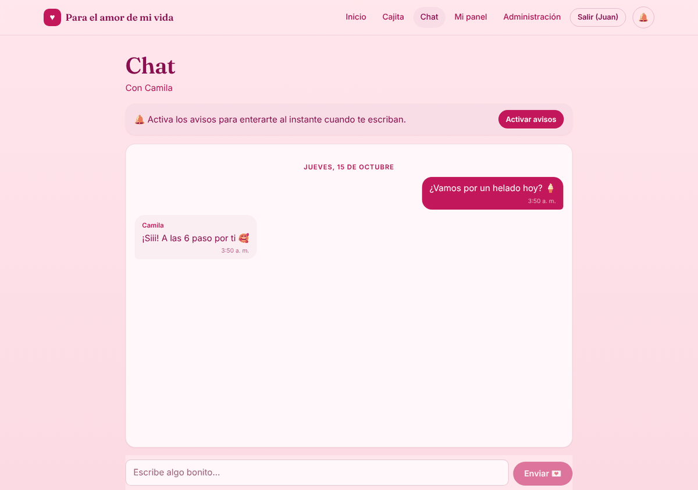
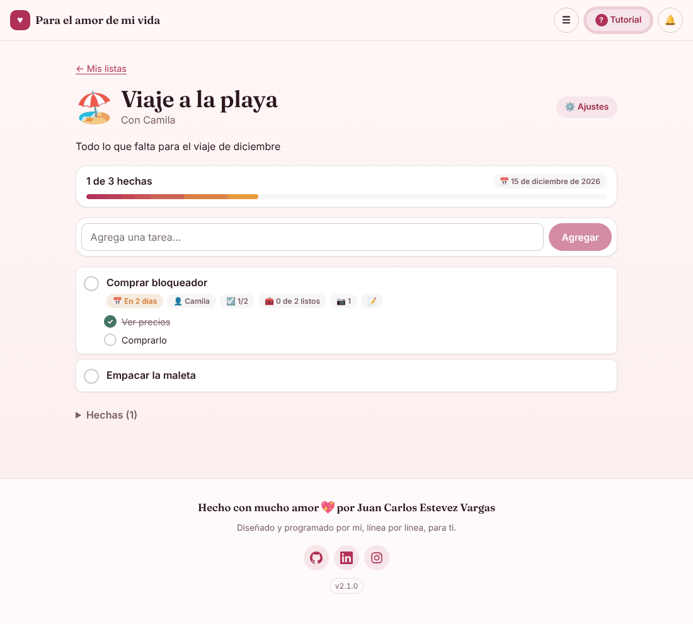
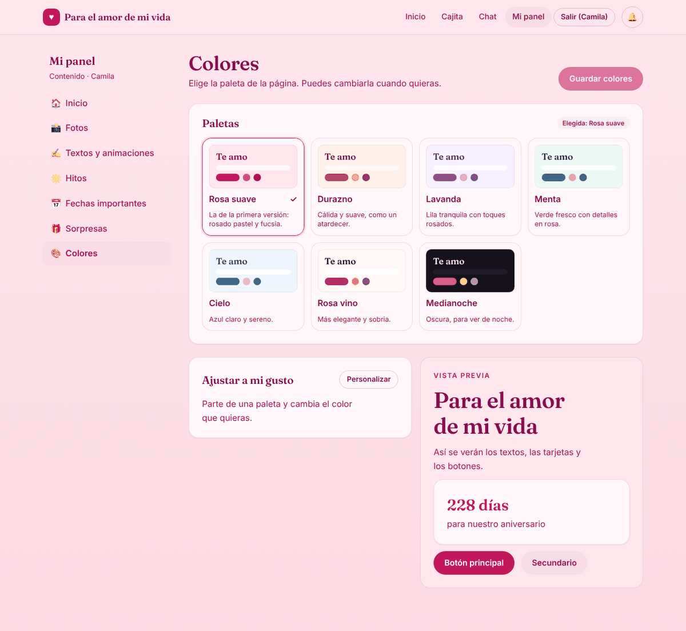
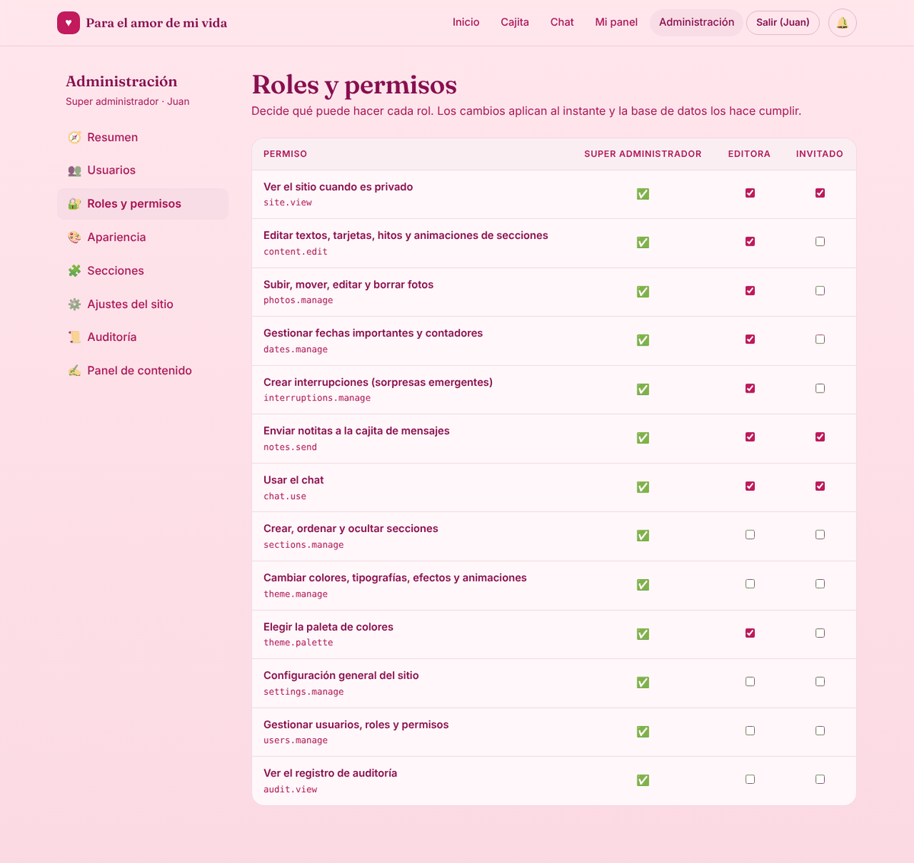
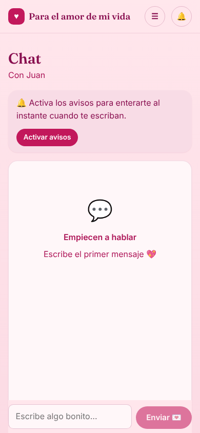

<div align="center">


# Para el amor de mi vida

**Una aplicación web privada para una pareja: recuerdos, fechas, chat en tiempo real y listas compartidas, con su propio panel de administración.**

[](https://github.com/Juan-Carlos-Estevez-Vargas/Camila-Sanchez/actions/workflows/ci.yml)
[](https://github.com/Juan-Carlos-Estevez-Vargas/Camila-Sanchez/actions/workflows/deploy.yml)
[](https://github.com/Juan-Carlos-Estevez-Vargas/Camila-Sanchez/releases)
[](LICENSE)


[**Ver en vivo**](https://camila-sanchez.netlify.app) ·
[Manual de usuario](docs/MANUAL_DE_USUARIO.md) ·
[Arquitectura](docs/ARQUITECTURA.md) ·
[Despliegue](docs/DESPLIEGUE.md)


</div>

## Tabla de contenido

- [Descripción](#descripción)
- [Capturas](#capturas)
- [Funcionalidades](#funcionalidades)
- [Tecnologías](#tecnologías)
- [Inicio rápido](#inicio-rápido)
- [Scripts](#scripts)
- [Arquitectura](#arquitectura)
- [Seguridad y privacidad](#seguridad-y-privacidad)
- [Accesibilidad y SEO](#accesibilidad-y-seo)
- [Despliegue y versiones](#despliegue-y-versiones)
- [Documentación](#documentación)
- [Contribuir](#contribuir)
- [Licencia](#licencia)

## Descripción

*Para el amor de mi vida* es una aplicación web progresiva (PWA) hecha a
medida para Camila. La página principal reúne la historia de la pareja:
tiempo juntos, cuentas regresivas a fechas especiales, hitos, una galería de
fotos por año y mes, una carta y sorpresas. Detrás hay un producto completo:
cuentas con roles y permisos, chat en tiempo real, listas de tareas
compartidas, avisos en la pantalla del celular y un panel para editar todo sin
tocar código.

Funciona en dos modos:

- **Producción**, con Supabase como backend (Postgres con Row Level Security,
  autenticación, almacenamiento privado, tiempo real y Edge Functions).
- **Demo**, sin cuentas ni configuración: todo se guarda en el navegador y dos
  pestañas se comunican entre sí, ideal para probarla en local.

> La primera versión (HTML/JS estático) se conserva en [`legacy/`](legacy/README.md).

## Capturas

| Chat en tiempo real | Listas compartidas |
| --- | --- |
|  |  |
| **Paletas de colores por persona** | **Roles y permisos** |
|  |  |

<p align="center">
  <br>
  <sub>Diseño adaptable: la misma app en el celular, instalable desde el navegador.</sub>
</p>

## Funcionalidades

| Área | Ruta | Acceso |
| --- | --- | --- |
| Página principal: portada, tiempo juntos, cuentas regresivas, notas, hitos, galería por año/mes, carta y frases | `/` | Pública o con `site.view` |
| Cajita de mensajes: notitas que se abren como una carta | `/mensajes` | `notes.send` |
| Chat tipo WhatsApp: fotos, stickers, responder citando, última conexión y vistos (✓ ✓✓) | `/chat` | `chat.use` |
| Listas compartidas con subtareas, materiales, fotos, fechas y responsables, en vivo | `/listas` | `lists.use` |
| Perfil: nombre, foto o icono, frase y cumpleaños | `/cuenta/perfil` | Cualquier cuenta |
| Mis colores: cada persona elige su paleta sin cambiársela a nadie | `/cuenta/colores` | Cualquier cuenta |
| Mi cuenta: avisos en el dispositivo, contraseña y sesiones | `/cuenta` | Cualquier cuenta |
| Panel de contenido: fotos, textos y animaciones, hitos, fechas y sorpresas | `/panel` | Editora y super admin |
| Super admin: usuarios, invitaciones por enlace o QR, roles y permisos, apariencia, secciones, ajustes y auditoría | `/super` | Super admin |
| Avisos push en el celular: chat, notitas, sorpresas y listas | — | Quien los active |
| Tutorial guiado según la página y los permisos de cada cuenta | Todas | Todos |

**Fotos optimizadas en el navegador.** Cada imagen pasa por un *pool* de Web
Workers con `OffscreenCanvas`: corrige la orientación EXIF, elimina metadatos
(GPS incluido), la reduce a 2048 px y la codifica en WebP (JPEG como respaldo)
hasta unos 450 KB, más una miniatura de 480 px. La carga masiva acepta
carpetas completas (hasta 1000 fotos por tanda), ubica cada foto en el mes en
que se tomó, salta duplicados con una huella SHA-256 y permite reintentar las
que fallen.

## Tecnologías

| Capa | Tecnología |
| --- | --- |
| Interfaz | React 19, TypeScript estricto, React Router 7 |
| Estilos | SCSS con módulos de Sass (`@use`/`@forward`), BEM y CSS Modules |
| Build y pruebas | Vite 8, Vitest, ESLint |
| Backend | Supabase: Postgres con RLS, Auth (PKCE), Storage privado, Realtime y Edge Functions en Deno |
| Avisos | Web Push (VAPID), service worker, `pg_net` y Supabase Vault |
| Calidad | Pruebas de RLS sobre PGlite, `npm audit`, Dependabot, acciones fijadas por SHA |
| Publicación | Netlify (web) y GitHub Actions (migraciones, funciones y releases) |

## Inicio rápido

Requisitos: **Node.js 20 o superior** (CI y Netlify usan Node 22).

```bash
git clone https://github.com/Juan-Carlos-Estevez-Vargas/Camila-Sanchez.git
cd Camila-Sanchez
npm install
npm run dev
```

Sin variables de entorno la app arranca en **modo demo**. Abre dos ventanas
para probar el chat y las notificaciones entre cuentas.

| Cuenta demo | Contraseña | Rol |
| --- | --- | --- |
| `juan@demo.local` | `demo1234` | Super administrador |
| `camila@demo.local` | `demo1234` | Editora |

Para conectarla a un proyecto de Supabase, copia `.env.example` a
`.env.local` y completa los valores. La guía completa está en
[docs/DESPLIEGUE.md](docs/DESPLIEGUE.md).

## Scripts

| Comando | Qué hace |
| --- | --- |
| `npm run dev` | Servidor de desarrollo (modo demo si no hay `.env.local`) |
| `npm run check` | Typecheck, lint y pruebas, lo mismo que exige CI |
| `npm run build` | Compilación de producción en `dist/` |
| `npm run preview` | Sirve la compilación de producción en local |
| `npm run db:setup-sql` | Regenera `supabase/setup.sql` a partir de las migraciones |
| `npm run release:preview` | Muestra la versión y las notas del próximo release |

## Arquitectura

```
src/
  app/        armazón: rutas, cabecera, pie de página, manejo de errores
  core/       configuración, validación, errores, EventBus, SEO
  domain/     reglas puras: tipos, permisos (RBAC), fechas, paletas, chat, listas
  data/       puerto Backend y adaptadores (Supabase | demo)
  services/   cola de tareas, pipeline de imágenes (workers), notificaciones
  state/      contextos: backend, auth, contenido, tema, notificaciones
  ui/         componentes reutilizables
  features/   site · auth · admin · super · messages · chat · lists · tour
  styles/     sistema de diseño en SCSS
supabase/
  migrations/ esquema, RLS, triggers de auditoría y avisos, buckets privados
  functions/  admin-users · redeem-invite · send-push
  tests/      pruebas de RLS sobre PGlite
```

- **Puertos y adaptadores:** la interfaz sólo conoce `Backend`
  (`src/data/ports.ts`); Supabase y el modo demo son implementaciones
  intercambiables.
- **Registry/Strategy:** cada tipo de sección registra su renderizador y su
  editor; agregar uno nuevo no toca el resto.
- **Observer:** `SiteContentStore` (con `useSyncExternalStore`) se refresca
  por colección cuando llega un cambio en tiempo real.
- **Fachada:** `PhotoUploader` orquesta workers, cola y almacenamiento.
- **Carga por ruta:** los estilos y el código de cada funcionalidad se
  descargan sólo cuando se visitan.

El detalle, con las decisiones y dónde tocar para cambiar algo, está en el
[manual de arquitectura](docs/ARQUITECTURA.md) y en los
[diagramas](docs/DIAGRAMAS.md).

## Seguridad y privacidad

La seguridad vive en la base de datos, no en el navegador.

- Row Level Security en todas las tablas y permisos resueltos en SQL
  (`has_permission`); triggers impiden escalar privilegios o quedarse sin
  super administrador.
- Registro público desactivado: sólo se entra con una cuenta creada por el
  administrador o con una **invitación de un solo uso** (token de 256 bits,
  guardado sólo como SHA-256 y enviado en el `#fragmento` de la URL).
- Fotos en buckets **privados** servidas con URLs firmadas; la clave
  `service_role` sólo existe dentro de las Edge Functions.
- Sesiones con PKCE, tokens de 1 hora con rotación de tokens de refresco,
  cierre de sesión en todos los dispositivos y recuperación de contraseña sin
  revelar qué correos existen.
- Cabeceras estrictas en producción: Content-Security-Policy, HSTS,
  `X-Frame-Options`, `Referrer-Policy`, `Permissions-Policy`, COOP y CORP.
- Límites de velocidad en la base, auditoría de cuentas, `npm audit` en CI y
  Dependabot.

Cobertura punto por punto del OWASP Top 10 y del API Security Top 10 en
[docs/SEGURIDAD_OWASP.md](docs/SEGURIDAD_OWASP.md). Para reportar una
vulnerabilidad, sigue la [política de seguridad](SECURITY.md).

## Accesibilidad y SEO

- Pensada para cumplir **WCAG 2.2 AA**: enlace para saltar al contenido, foco
  visible, navegación por teclado, contraste revisado y respeto a
  *reducir movimiento*.
- Metadatos por ruta (título, descripción, canónica, Open Graph, Twitter Card
  y JSON-LD), `robots.txt` y `sitemap.xml` generados en el build. Las zonas
  privadas son siempre `noindex` y `VITE_SEO_INDEX=false` apaga la indexación.

Más en [docs/ACCESIBILIDAD.md](docs/ACCESIBILIDAD.md).

## Despliegue y versiones

Cada merge a `master` se despliega solo:

1. **Netlify** compila con `npm run build` y publica `dist/`.
2. El flujo [`Deploy`](.github/workflows/deploy.yml) aplica las migraciones
   nuevas, configura el inicio de sesión, publica las Edge Functions y deja
   listos los avisos push.
3. Se crea un **release** `vX.Y.Z` con notas agrupadas por tipo. La versión
   sigue [SemVer](https://semver.org/lang/es/) a partir de los mensajes de
   commit ([Conventional Commits](https://www.conventionalcommits.org/es/)).

La puesta en marcha desde cero (Supabase, secretos de GitHub, cuentas y
Netlify) está paso a paso en [docs/DESPLIEGUE.md](docs/DESPLIEGUE.md).

## Documentación

| Documento | Para quién |
| --- | --- |
| [Manual de usuario](docs/MANUAL_DE_USUARIO.md) | Quien usa la app: visitantes, Camila y Juan |
| [Manual de arquitectura](docs/ARQUITECTURA.md) | Quien mantiene o extiende el código |
| [Diagramas](docs/DIAGRAMAS.md) | Flujos, secuencias, despliegue, modelo de datos y permisos (Mermaid) |
| [Despliegue y operación](docs/DESPLIEGUE.md) | Quien pone la app en producción o la administra |
| [Seguridad OWASP](docs/SEGURIDAD_OWASP.md) | Cómo se cubre cada riesgo del OWASP Top 10 y del API Security Top 10 |
| [Accesibilidad y SEO](docs/ACCESIBILIDAD.md) | Cómo se cumple WCAG 2.2 AA y qué se hace para los buscadores |

## Contribuir

Es un proyecto personal, pero las sugerencias y los reportes de errores son
bienvenidos. Lee la [guía de contribución](CONTRIBUTING.md) antes de abrir un
issue o un pull request.

## Licencia

El código se publica bajo la [licencia MIT](LICENSE). Las fotos, los textos
personales y las capturas de pantalla **no** están cubiertos por esa licencia
y no pueden reutilizarse.

<div align="center">
<sub>Hecho con mucho amor 💖 por <a href="https://github.com/Juan-Carlos-Estevez-Vargas">Juan Carlos Estevez Vargas</a>.</sub>
</div>
