# Diagramas

Diagramas de la app en [Mermaid](https://mermaid.js.org/). GitHub los dibuja
directamente al abrir este archivo. La explicación de cada pieza está en
[ARQUITECTURA.md](ARQUITECTURA.md).

- [Arquitectura general](#arquitectura-general)
- [Capas del frontend](#capas-del-frontend)
- [Navegación y permisos](#navegación-y-permisos)
- [Inicio de sesión](#inicio-de-sesión)
- [Invitación por enlace o QR](#invitación-por-enlace-o-qr)
- [Recuperación de contraseña](#recuperación-de-contraseña)
- [Subida de fotos](#subida-de-fotos)
- [Notitas, chat y notificaciones](#notitas-chat-y-notificaciones)
- [Chat: respuestas, conexión y vistos](#chat-respuestas-conexión-y-vistos)
- [Chat: fotos y stickers](#chat-fotos-y-stickers)
- [Tutorial guiado](#tutorial-guiado)
- [Integración y despliegue](#integración-y-despliegue)
- [Modelo de datos](#modelo-de-datos)
- [Roles y permisos](#roles-y-permisos)

## Arquitectura general

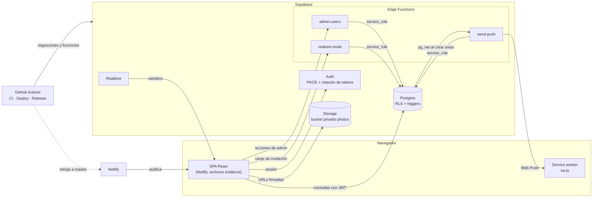

## Capas del frontend

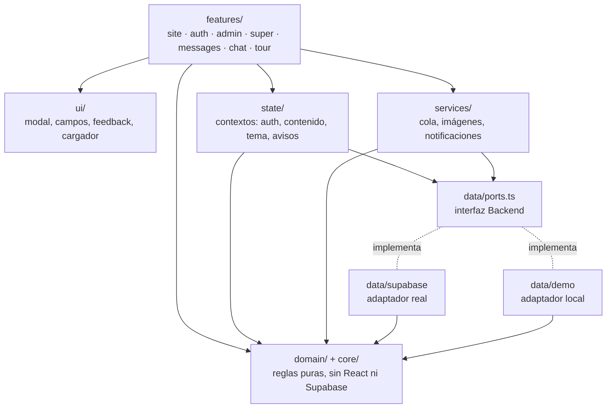

## Navegación y permisos

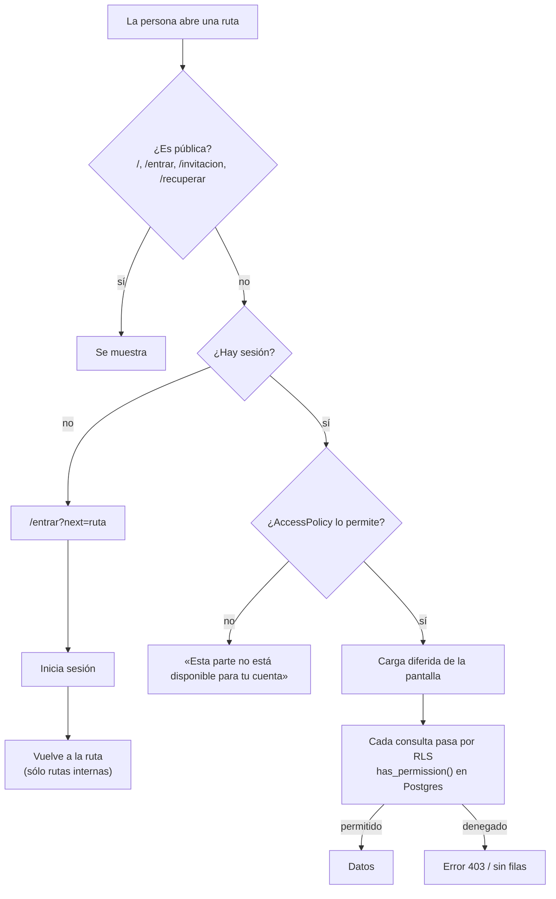

## Inicio de sesión

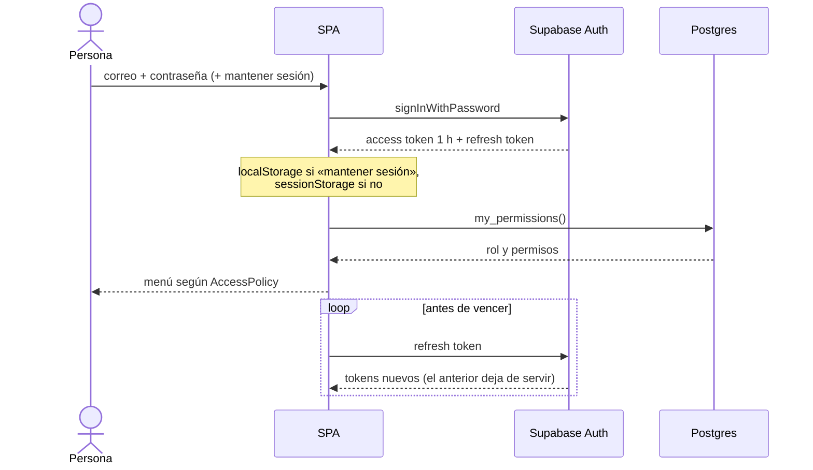

## Invitación por enlace o QR

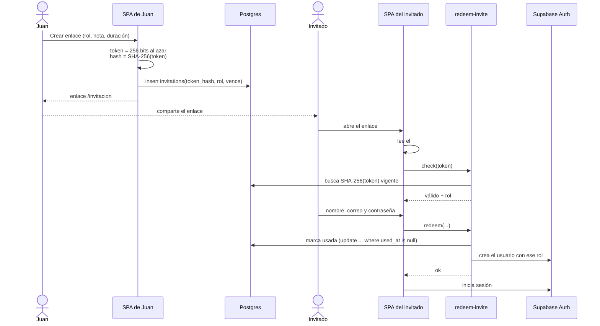

## Recuperación de contraseña

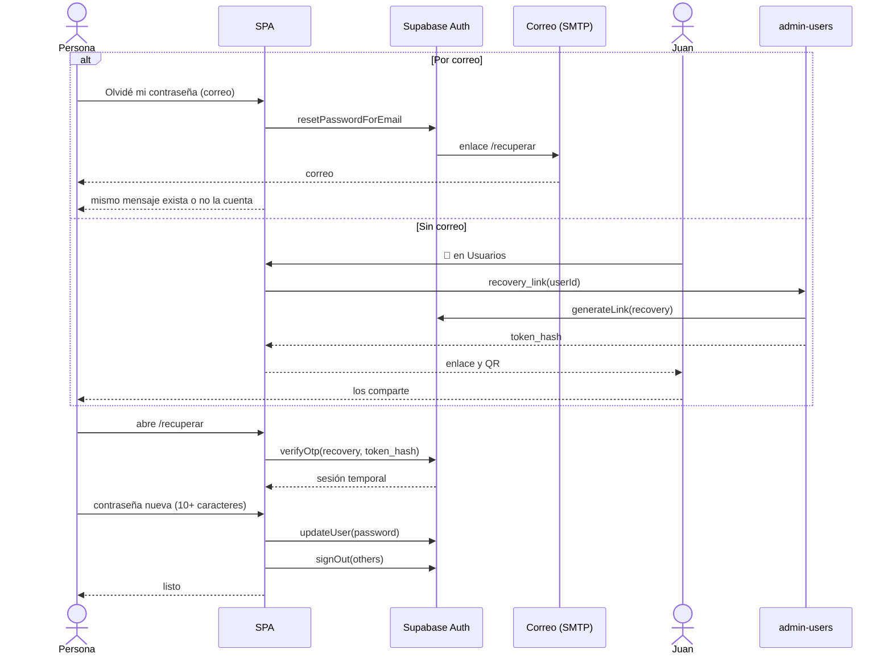

## Subida de fotos

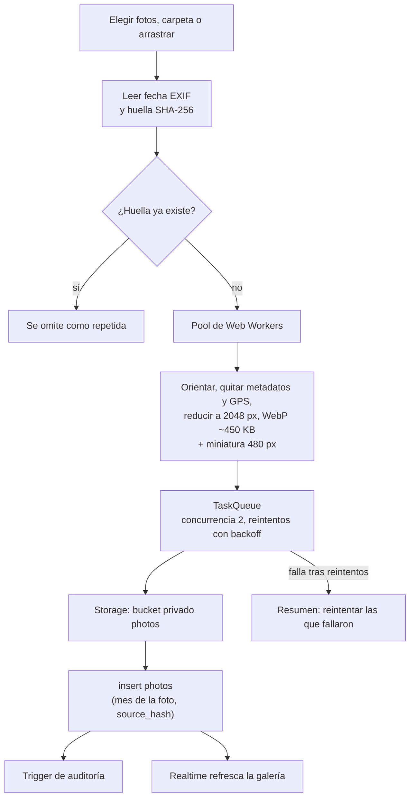

## Notitas, chat y notificaciones

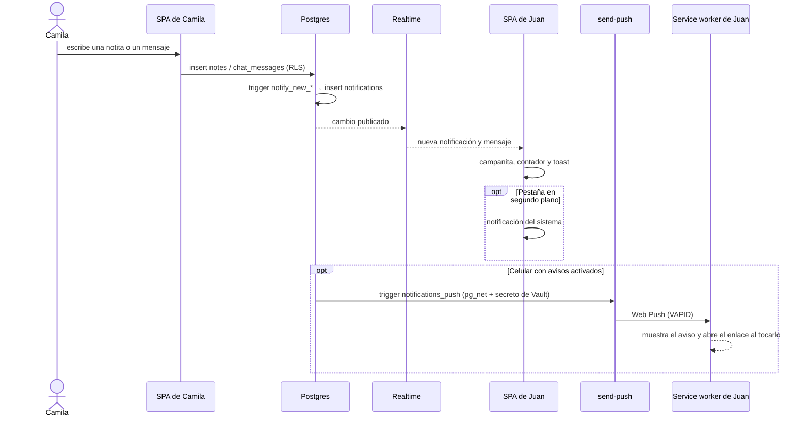

## Chat: respuestas, conexión y vistos

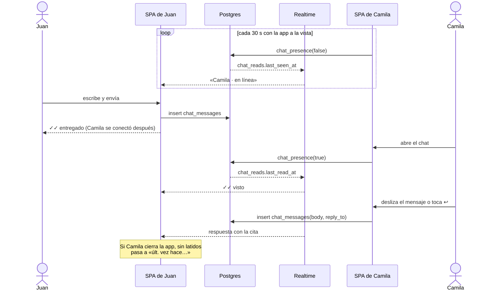

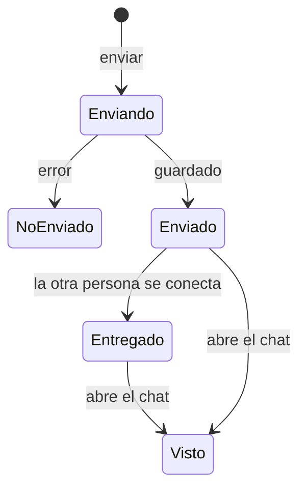

## Chat: fotos y stickers

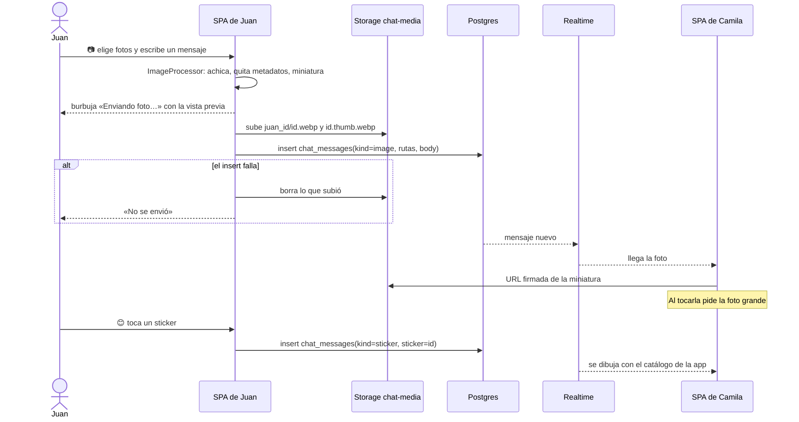

## Tutorial guiado

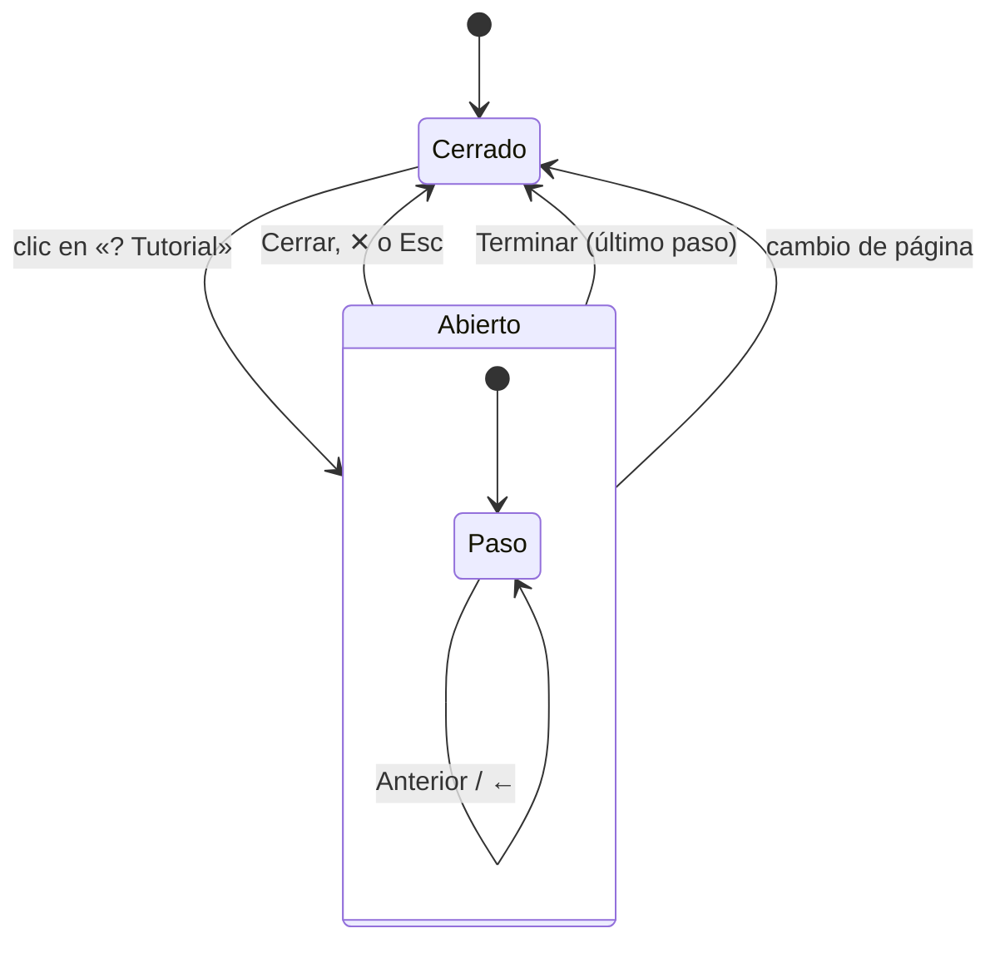

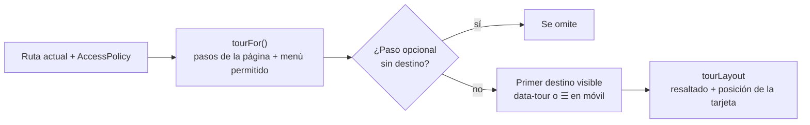

## Integración y despliegue

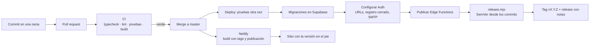

## Modelo de datos

```mermaid
erDiagram
  AUTH_USERS ||--|| PROFILES : "tiene"
  PROFILES }o--|| ROLE : "rol"
  ROLE ||--o{ ROLE_PERMISSIONS : "concede"
  PERMISSIONS ||--o{ ROLE_PERMISSIONS : "en"
  PROFILES ||--o{ INVITATIONS : "crea"
  AUTH_USERS ||--o| INVITATIONS : "usa"
  AUTH_USERS ||--o{ NOTES : "envía / recibe"
  AUTH_USERS ||--o{ CHAT_MESSAGES : "escribe"
  AUTH_USERS ||--o| CHAT_READS : "conexión y vistos"
  CHAT_MESSAGES |o--o{ CHAT_MESSAGES : "responde a"
  AUTH_USERS ||--o{ NOTIFICATIONS : "recibe"
  AUTH_USERS ||--o{ PUSH_SUBSCRIPTIONS : "dispositivos"
  AUTH_USERS ||--o{ INTERRUPTION_VIEWS : "vio"
  INTERRUPTIONS ||--o{ INTERRUPTION_VIEWS : "vista por"
  PHOTOS ||--o{ MILESTONES : "ilustra"
  AUTH_USERS ||--o{ AUDIT_LOG : "actor"

  PROFILES {
    uuid id PK
    text display_name
    app_role role
    boolean is_active
    jsonb theme_colors "colores propios"
  }
  PERMISSIONS {
    text key PK
    text description
  }
  ROLE_PERMISSIONS {
    app_role role PK
    text permission PK
  }
  INVITATIONS {
    uuid id PK
    text token_hash "SHA-256"
    app_role role "nunca super_admin"
    timestamptz expires_at
    timestamptz used_at
  }
  SITE_SETTINGS {
    smallint id PK "siempre 1"
    text site_title
    date relationship_start
    boolean is_public
    jsonb theme
  }
  SECTIONS {
    uuid id PK
    section_kind kind
    jsonb content
    int position
    boolean is_visible
  }
  PHOTOS {
    uuid id PK
    text storage_path
    text thumb_path
    date taken_on
    text source_hash "SHA-256"
  }
  MILESTONES {
    uuid id PK
    text title
    date happened_on
    uuid photo_id FK
  }
  IMPORTANT_DATES {
    uuid id PK
    text title
    date event_date
    boolean recurs_yearly
  }
  INTERRUPTIONS {
    uuid id PK
    text title
    interruption_style style
    timestamptz starts_at
    boolean show_once
  }
  NOTES {
    uuid id PK
    uuid sender_id FK
    uuid recipient_id FK
    note_kind kind
    timestamptz read_at
  }
  CHAT_MESSAGES {
    uuid id PK
    uuid sender_id FK
    chat_kind kind "text, image, sticker"
    text body
    uuid reply_to FK "mensaje citado"
    text image_path "chat-media/<user_id>/..."
    text thumb_path
    text sticker "id del catálogo"
  }
  CHAT_READS {
    uuid user_id PK
    timestamptz last_seen_at "última conexión"
    timestamptz last_read_at "hasta dónde leyó"
  }
  NOTIFICATIONS {
    uuid id PK
    uuid user_id FK
    text kind "note, chat, system"
    text link
    timestamptz read_at
  }
  AUDIT_LOG {
    bigint id PK
    uuid actor_id FK
    text action
    text table_name
    jsonb old_data
    jsonb new_data
  }
```

`ROLE` representa el tipo enumerado `app_role` (`super_admin`, `editor`,
`viewer`), no una tabla. `SITE_SETTINGS`, `SECTIONS` e `IMPORTANT_DATES` no
tienen relaciones fuertes: los lee cualquiera con `site.view`.

## Roles y permisos

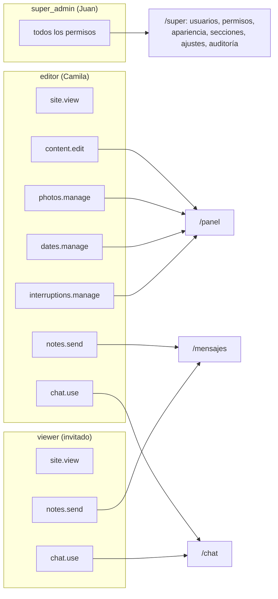

Estos son los permisos por defecto (migración `core_schema`). Juan los cambia
en **Administración → Roles y permisos** y la base de datos los aplica al
instante.
